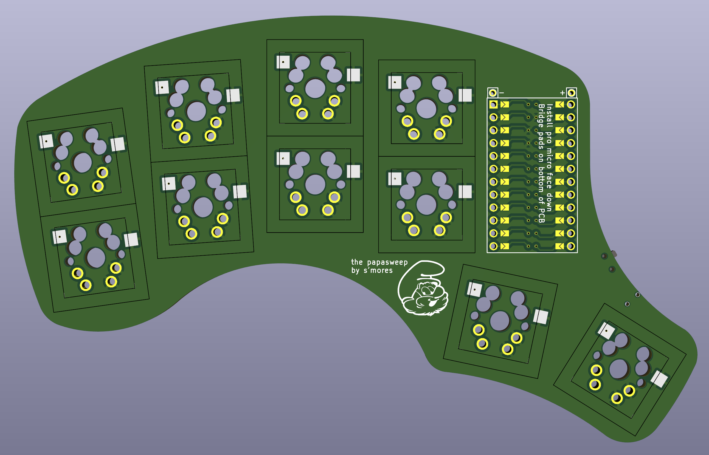

The Papasweep
=============

The papasweep is a one-handed reversible keyboard designed for typing with the [Taipo layout](https://inkeys.wiki/en/keymaps/taipo). It is based on the [pepesweep](https://github.com/XaycMD/pepesweep), but it is MX, and much wider for accomodating bigger hands.

You can order one by uploading the `papasweep.zip` gerber archive to JLCPCB.

